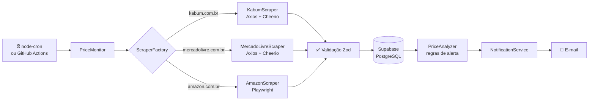

<div align="center">

# 📉 Monitor de Preços

**Web scraping + histórico de preços + alertas inteligentes por e-mail**

[](https://github.com/SEU-USUARIO/monitor-de-precos/actions/workflows/ci.yml)


</div>

---

## 🎯 O problema

Preço em e-commerce brasileiro muda o tempo todo. Quem quer comprar um produto pelo melhor valor precisa abrir a página várias vezes por dia e ainda assim não sabe se o "desconto" é real ou se o preço foi inflado antes da promoção.

## 💡 A solução

O **Monitor de Preços** faz esse trabalho sozinho:

1. **Coleta** periodicamente o preço dos produtos cadastrados (Kabum, Mercado Livre e Amazon).
2. **Armazena** cada coleta no PostgreSQL (Supabase), formando uma série histórica.
3. **Analisa** o preço atual contra a sua meta e contra o histórico.
4. **Alerta por e-mail** só quando vale a pena, sem spam.

| Alerta                       | Quando dispara                                                 |
| ---------------------------- | -------------------------------------------------------------- |
| 🎯 **Meta atingida**         | preço atual ≤ preço-alvo que você definiu                      |
| 📉 **Queda contra a média**  | preço ≥ 10% abaixo da média dos últimos 30 dias (configurável) |
| 🏆 **Menor preço histórico** | preço abaixo de qualquer valor já registrado                   |

> O **cooldown** impede que o mesmo alerta se repita em menos de 24h, a não ser que o preço caia ainda mais.

O e-mail traz o produto, o preço atual, o preço "de", os motivos do alerta com a variação percentual, a média de 30 dias e um botão **Ver na loja**.

---

## 🏗️ Arquitetura



### Padrões de projeto aplicados

| Padrão                     | Onde                                                    | Benefício                                                                                     |
| -------------------------- | ------------------------------------------------------- | --------------------------------------------------------------------------------------------- |
| **Strategy**               | `src/scrapers/stores/*`, `src/notifications/channels/*` | Cada loja/canal é uma classe intercambiável.                                                  |
| **Factory**                | `ScraperFactory`                                        | Escolhe a estratégia pelo domínio da URL. Nova loja = 1 arquivo + 1 linha.                    |
| **Template Method**        | `BaseScraper.scrape()`                                  | Fluxo fixo (delay → retry → anti-bot → extração → validação). As lojas só declaram seletores. |
| **Repository**             | `src/database/*Repository.js`                           | Isola o Supabase; os testes usam mocks.                                                       |
| **Injeção de dependência** | `PriceMonitor`, `container.js`                          | Tudo testável sem rede, banco ou SMTP reais.                                                  |

### Decisões técnicas que valem destacar

- **Extração em 3 camadas: JSON-LD → meta tags → CSS.** As lojas publicam dados estruturados (`schema.org/Product`) para o Google. Eles mudam muito menos que o layout, então o scraper continua funcionando quando o site é redesenhado.
- **Anti-bloqueio:** rotação de User-Agents, cabeçalhos de navegador real, delay aleatório entre requisições, concorrência limitada e detecção de páginas de captcha.
- **Retry com backoff exponencial + jitter**, só para erros transitórios (timeout, 5xx, 429). Um erro de parsing nunca é repetido à toa.
- **Isolamento de falhas:** um produto bloqueado não interrompe os demais. Uma falha no e-mail não perde o preço já coletado.
- **Erros tipados** (`BlockedError`, `ParseError`, `DatabaseError`...) com contexto estruturado nos logs (Pino).
- **Fail fast:** o `.env` é validado com Zod na inicialização, com mensagem listando todos os problemas.
- **Dinheiro como `numeric(12,2)`**, nunca `float`.
- **Playwright sob demanda:** só é carregado (`import()` dinâmico) se houver produto de loja dinâmica.

---

## 📁 Estrutura

```
├── .github/workflows/     # CI (lint + testes) e execução agendada
├── database/              # Scripts SQL do Supabase + documentação do modelo
├── src/
│   ├── cli/               # CLI de gerenciamento de produtos
│   ├── config/            # Validação do .env (Zod) e logger (Pino)
│   ├── database/          # Cliente Supabase e repositórios
│   ├── errors/            # Hierarquia de erros tipados
│   ├── notifications/     # NotificationService, canais e template de e-mail
│   ├── schemas/           # Schemas Zod
│   ├── scrapers/          # BaseScraper, Factory, extratores e lojas
│   ├── services/          # PriceMonitor (orquestrador) e PriceAnalyzer (regras)
│   ├── utils/             # parsePrice, retry, concorrência, user agents
│   ├── container.js       # Composition root
│   ├── index.js           # Daemon (node-cron)
│   └── run-once.js        # Execução única (GitHub Actions)
└── tests/
    ├── fixtures/          # HTML salvo das lojas
    ├── mocks/             # Mock do Supabase
    ├── unit/
    └── integration/
```

---

## 🚀 Como rodar localmente

### Pré-requisitos

- [Node.js](https://nodejs.org/) **22.12 ou superior**
- Conta gratuita no [Supabase](https://supabase.com/)
- Conta Gmail com **verificação em duas etapas** ativada (para gerar a senha de app)

### 1. Clonar e instalar

```bash
git clone https://github.com/SEU-USUARIO/monitor-de-precos.git
cd monitor-de-precos
npm install
```

> Vai monitorar produtos da **Amazon**? Instale também o navegador do Playwright:
> `npx playwright install chromium`

### 2. Configurar o Supabase

1. Em [supabase.com/dashboard](https://supabase.com/dashboard), clique em **New project** e aguarde a criação.
2. Abra **SQL Editor → New query** e execute, **nesta ordem**, o conteúdo de:
   1. [`database/001_schema.sql`](database/001_schema.sql): tabelas, índices e trigger
   2. [`database/002_views.sql`](database/002_views.sql): view de estatísticas
   3. [`database/003_rls.sql`](database/003_rls.sql): segurança (RLS)
3. Em **Project Settings → API**, copie:
   - **Project URL** → `SUPABASE_URL`
   - **service_role key** (secreta) → `SUPABASE_SERVICE_ROLE_KEY`

> ⚠️ A `service_role` ignora o RLS. Use-a **somente no backend** e nunca faça commit dela.

Detalhes do modelo de dados em [`database/README.md`](database/README.md).

### 3. Configurar o e-mail (Gmail)

1. Acesse [myaccount.google.com/apppasswords](https://myaccount.google.com/apppasswords).
2. Crie uma senha de app (ex.: "Monitor de Preços") e copie os 16 caracteres.
3. Use o seu e-mail em `SMTP_USER` e `EMAIL_TO`, e a senha gerada em `SMTP_PASS`.

### 4. Criar o `.env`

```bash
cp .env.example .env
```

Preencha as variáveis. Todas estão documentadas no [`.env.example`](.env.example).

### 5. Testar a configuração

```bash
# Testa a coleta de uma URL (não precisa de banco nem e-mail)
npm run produto -- test-scrape --url "https://www.kabum.com.br/produto/..."

# Envia um e-mail de exemplo para EMAIL_TO
npm run produto -- test-email
```

### 6. Cadastrar produtos e rodar

```bash
# Cadastra (o nome é obtido automaticamente da página)
npm run produto -- add --url "https://www.kabum.com.br/produto/..." --alvo 1499.90

npm run produto -- list          # lista os produtos
npm run monitor:once             # executa um ciclo agora
npm start                        # modo contínuo (a cada 6h, configurável)
```

---

## ☁️ Rodando de graça no GitHub Actions

O workflow [`scrape.yml`](.github/workflows/scrape.yml) executa o monitor **a cada 6 horas**, sem servidor.

1. No repositório: **Settings → Secrets and variables → Actions → New repository secret**.
2. Crie os secrets: `SUPABASE_URL`, `SUPABASE_SERVICE_ROLE_KEY`, `SMTP_USER`, `SMTP_PASS`, `EMAIL_TO`.
3. Na aba **Actions**, abra "Monitorar preços" e use **Run workflow** para testar.

---

## 🧪 Testes

```bash
npm test                 # executa a suíte
npm run test:coverage    # com relatório de cobertura (coverage/index.html)
```

- **176 testes**, ~97% de cobertura de linhas.
- **Nenhum teste acessa a internet ou o banco.** Os scrapers rodam contra HTML salvo em `tests/fixtures/`, o Supabase é substituído por um mock encadeável (`tests/mocks/supabase.mock.js`), o HTTP por um cliente falso injetado e o Playwright por um navegador simulado.
- O teste de integração (`tests/integration/PriceMonitor.test.js`) cobre o ciclo completo: isolamento de falhas, cooldown, falha de e-mail sem perda de dados etc.

---

## ➕ Adicionando uma nova loja

```js
// src/scrapers/stores/NovaLojaScraper.js
import { BaseScraper } from '../BaseScraper.js';

export class NovaLojaScraper extends BaseScraper {
  static loja = 'nova_loja';
  static dominios = ['novaloja.com.br'];
  static seletores = { titulo: ['h1'], preco: ['.preco-final'] };
}
```

Depois, registre a classe em `ScraperFactory.js`, adicione o valor em `LOJAS` e no enum do banco. O passo a passo completo está no [`CLAUDE.md`](CLAUDE.md).

---

## 🗺️ Próximos passos

- [ ] Canal de notificação via **Telegram** (a interface de canais já está pronta)
- [ ] Dashboard web com gráfico do histórico de preços
- [ ] Suporte a mais lojas (Magazine Luiza, Pichau, Terabyte)
- [ ] Proxy rotativo para lojas com anti-bot agressivo

---

## ⚖️ Uso responsável

Projeto para fins **educacionais e uso pessoal**. Ele respeita intervalos entre requisições e limita a concorrência para não sobrecarregar as lojas. Antes de usar, consulte os Termos de Uso e o `robots.txt` de cada site. Os seletores podem parar de funcionar quando as lojas mudam o layout.

## 📄 Licença

Distribuído sob a licença MIT. Veja [`LICENSE`](LICENSE).
