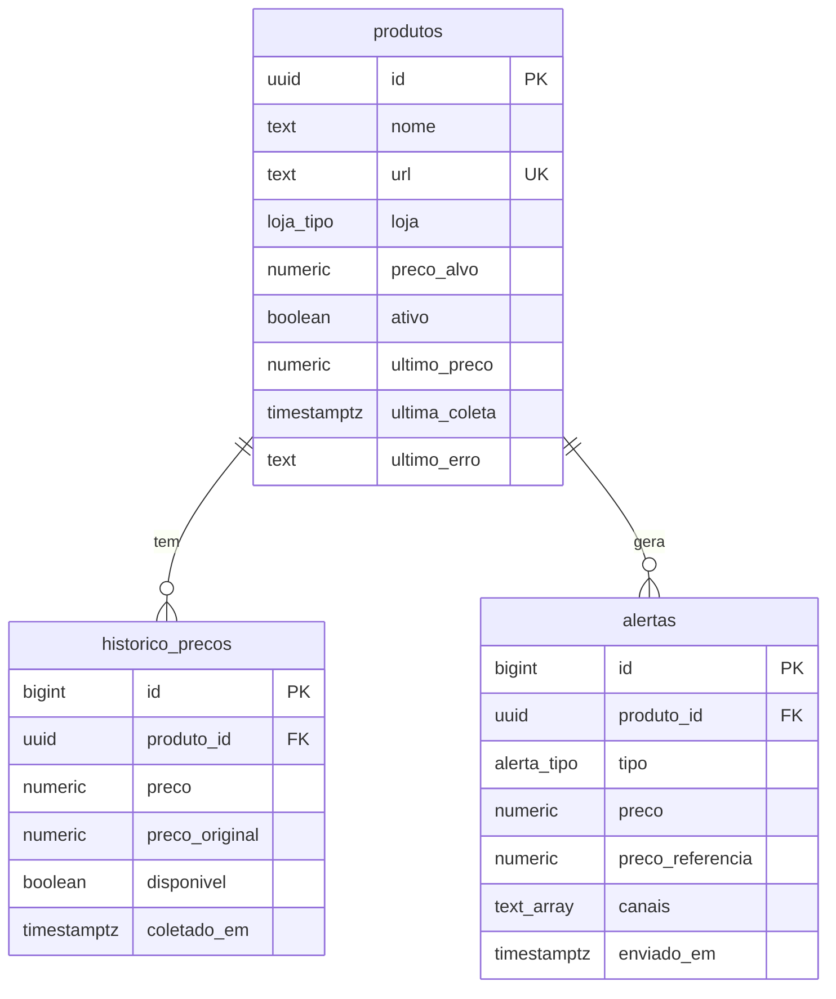

# Banco de dados (Supabase / PostgreSQL)

Execute os scripts **nesta ordem** no **SQL Editor** do Supabase (`SQL Editor > New query`):

| Ordem | Arquivo                            | O que faz                                                                                                                                 |
| ----: | ---------------------------------- | ----------------------------------------------------------------------------------------------------------------------------------------- |
|     1 | [`001_schema.sql`](001_schema.sql) | Cria os tipos `loja_tipo` e `alerta_tipo`, as tabelas `produtos`, `historico_precos` e `alertas`, os índices e o trigger de `updated_at`. |
|     2 | [`002_views.sql`](002_views.sql)   | Cria a view `v_estatisticas_produto` (média/mínimo de 30 dias e menor preço histórico).                                                   |
|     3 | [`003_rls.sql`](003_rls.sql)       | Ativa Row Level Security em todas as tabelas.                                                                                             |
|     4 | [`seed.sql`](seed.sql)             | _(Opcional)_ Insere produtos de exemplo.                                                                                                  |

## Modelo de dados



## Decisões de modelagem

- **`numeric(12,2)` para dinheiro.** Ponto flutuante (`float`) gera erros de arredondamento (`0.1 + 0.2 != 0.3`).
- **`enum` para loja.** Garante integridade. O valor precisa bater com `static loja` da classe do scraper.
- **`ultimo_preco` / `ultima_coleta` desnormalizados em `produtos`.** A listagem fica rápida sem agregar o histórico inteiro.
- **Índice composto `(produto_id, coletado_em desc)`.** Atende a consulta mais frequente: histórico recente de um produto.
- **Tabela `alertas`.** Serve de auditoria e implementa o _cooldown_ (não repetir o mesmo alerta em menos de N horas).
- **View com `security_invoker = true`.** A view respeita o RLS de quem consulta (boa prática do Supabase/PG15+).
- **RLS ativo sem policies.** A chave pública `anon` não acessa nada. Apenas o backend, com a `service_role`, lê e escreve.

## Adicionando uma nova loja

```sql
alter type public.loja_tipo add value 'nova_loja';
```

E crie a classe correspondente em `src/scrapers/stores/` (veja o `CLAUDE.md` na raiz).

## Consultas úteis

```sql
-- Últimos 20 preços de um produto
select preco, disponivel, coletado_em
from historico_precos
where produto_id = '<uuid>'
order by coletado_em desc
limit 20;

-- Situação geral
select nome, loja, ultimo_preco, preco_alvo, ultima_coleta, ultimo_erro
from produtos
order by ultima_coleta desc nulls last;

-- Estatísticas
select * from v_estatisticas_produto;
```
